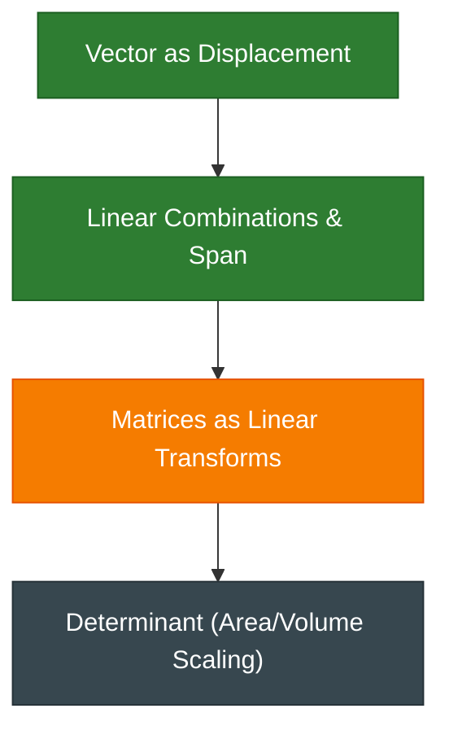

# Knowledge Graph — Live Representation
*Last Updated: 2026-10-27 03:50:11*

### Legend
- 🟢 **Green (Mastered):** Confirmed understanding via active recall.
- 🟠 **Orange (Learning):** Active in-progress topic.
- 🔴 **Red (Gap / Misconception):** Diagnosed misconception to repair.
- ⚪ **Gray (Planned):** Next dependency path.
