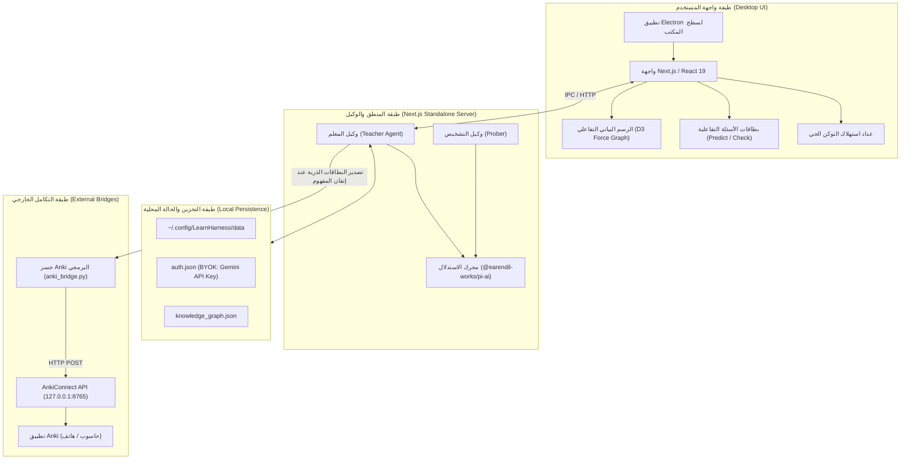

# وثيقة التصميم التقني: محرك التعلم السقراطي المدمج مع أنكي وواجهة Electron (LearnHarness)

* **المؤلف:** باسل / Antigravity
* **التاريخ:** 2026-10-27
* **الحالة:** معتمد (الخطوة 2: بيان المشكلة، المبادئ العشرة، قرار اعتماد واجهة Electron، والأهداف)

---

## 1. بيان المشكلة (The Problem)

يواجه المتعلمون للمواضيع الرياضية والتقنية العميقة (الجبر الخطي، معمارية النماذج اللغوية LLMs، التعلم العميق، الرؤية الحاسوبية) نمطين متناقضين من الفشل في الأدوات الحالية:
1. **فخ التلقي السلبي ووهم الطلاقة (Fluency Illusion):** قراءة الكتب أو مشاهدة الشروحات تعطي المتعلم شعوراً زائفاً بالفهم لمجرد وضوح الشرح، لكنه يعجز عن اشتقاق المفاهيم أو تطبيقها بشكل مستقل.
2. **إرهاق البطاقات والتفكك المفاهيمي (Flashcard Burnout):** أدوات التكرار المتباعد التقليدية (مثل Anki) تفتت المعرفة إلى حقائق معزولة. يعاني المتعلم من إجهاد كتابة البطاقات يدوياً، ويفقد شجرة الاعتماديات الهيكلية التي تربط أساسيات الجبر الخطي بنماذج الذكاء الاصطناعي، وينتهي به الأمر بحفظ نصوص الإجابات دون فهم اشتقاقي حقيقي.

**قيود وشروط المتعلم الصارمة:**
- **صفر كتابة يدوية:** عدم كتابة أي ملاحظات أو صياغة بطاقات أنكي يدوياً.
- **حد أدنى من القراءة:** تجنب النصوص الإنشائية الطويلة والمملة والتركيز على التفاعل الكثيف والسريع.
- **التعلم بالاشتقاق والمبادئ الأولى:** تثبيت المفاهيم وبناء الاعتماديات قبل الانتقال لما بعدها.

---

## 2. المنهجية الجوهرية: ركائز ومبادئ التعلم العميق العشرة (The 10 Core Doctrines)

يتبنى النظام منهجية LearnHarness المستقاة من أساليب الشرح الرياضي العميق (مثل 3Blue1Brown) والتي تتلخص في 10 قواعد تعليمية صارمة:

1. **الانطلاق من الحقائق غير المشروطة أولاً (Unconditional Truths First):** لا نبدأ من نظريات مشتقة، بل من بديهيات قطعية يقبلها العقل دون شروط أو استثناءات لتوفير أرضية صلبة تمنع تشكك الدماغ.
2. **دافع الاكتشاف الذاتي ("How Could I Have Discovered This?"):** لا تفرض أي معادلة أو معمارية كأمر واقع أو اعتباطي، بل اشرح المشكلة الأصلية التي اضطرت العلماء لاختراع هذا الحل خطوة بخطوة.
3. **خطوة استدلالية واحدة في كل مرة (One Reasoning Step at a Time):** كل خطوة تنقل المتعلم من حقيقة واضحة إلى النتيجة التالية مباشرة؛ إذا احتاجت الفكرة شرحين، تُقسّم إلى خطوتين.
4. **التشخيص الاستكشافي المسبق بالبحث الثنائي (Binary-Search Probing):** قياس حدود معرفة المتعلم وحصرها بدقة (تحديد سقف ما يجهله وأرضية ما يتقنه) قبل تقديم أي شرح جديد.
5. **حلقة (توقع -> شرح -> فحص) (Predict → Teach → Check):**
   - **التوقع (Predict):** إلزامه بتخمين السلوك القادم قبل كشف الإجابة لشد انتباهه.
   - **الشرح (Teach):** بيان الفكرة بأسلوب اشتقاقي مبسط ومسبب.
   - **الفحص (Check):** اختبار فوري بمسألة تطبيقية للتأكد من رسوخ المفهوم.
6. **التطبيق وليس الترديد (Application over Recitation):** الأسئلة تختبر القدرة على استخدام المفهوم في حالات جديدة، وتمنع تماماً أسئلة الحفظ التي تكرر كلمات النموذج.
7. **كشف وتسمية النماذج الخاطئة مبكراً (Name the Misconception):** صياغة خيارات الفحص بحيث يكشف الخطأ عن النموذج العقلي الخاطئ للمتعلم لعلاجه فوراً قبل البناء عليه.
8. **شجرة الاعتماديات الدنيا (Minimal Dependency Tree):** الخطة التعليمية لا تدرس ما يعرفه مسبقاً، ولا تنحرف عن الهدف النهائي؛ المسار هو أقصر خط اشتقاقي ممكن.
9. **مرونة الخريطة مع استجابة المتعلم (The Map Moves With Him):** الخطة ليست جدولاً ثابتاً، بل فرضية تتغير وتتسع وتتعدل فورياً كلما كشفت إجابات المتعلم عن ثغرة خفية.
10. **مبدأ الحد الأدنى من المعلومات في التثبيت (Minimum Information Principle):** تلخيص كل مفهوم تم إتقانه في بطاقتين أو ثلاث بطاقات Anki ذرية فائقة السرعة للمراجعة في ثوانٍ.

---

## 3. قرار معمارية واجهة المستخدم: اعتماد تطبيق سطح المكتب (Electron GUI Decision)

**القرار المعماري:** تم اعتماد بناء وتشغيل **واجهة Electron الأصلية** للمشروع، وذلك لتحقيق المزايا البصرية والتفاعلية الكاملة:
1. **الخريطة البصرية التفاعلية (Interactive D3 Force Graph):** استعراض شجرة الاعتماديات كشبكة كروية متحركة ثنائية وثلاثية الأبعاد قابلة للتكبير والسحب والفرز التفاعلي.
2. **عداد الاستهلاك الحي (Live Token & Cost Meter):** عرض استهلاك التوكن وتكلفة الأسئلة والأجوبة في زاوية الشاشة بشكل مرئي مباشر.
3. **أزرار الفحص السلسة (Interactive Quiz Cards):** بطاقات فحص الفهم التفاعلية المنبثقة القابلة للطي والمطابقة للمنهجية السقراطية.
4. **تطبيق مستقل:** فصل جلسة التعلم والاستيعاب البصري داخل نافذة سطح مكتب متخصصة، مع الحفاظ على قدرة AGY على التحكم بالخلفية وإدارة الجلسات.

---

## 4. الأهداف وغير الأهداف (Goals and Non-Goals)

### الأهداف الداخلة في النطاق (In-Scope Goals)
- تثبيت وتشغيل واجهة **Electron Desktop Application** بكامل ميزاتها البصرية (D3 Graph، عداد التوكن، بطاقات الأسئلة التفاعلية).
- تطبيق المبادئ التعليمية العشرة كاملة في صياغة الحوار واشتقاق النماذج الرياضية من المبادئ الأولى.
- دمج جسر Anki الآلي لحقن بطاقات المراجعة الذرية فائقة السرعة عبر `AnkiConnect`.
- دعم التبديل السلس بين مزودي النماذج اللغوية (Google AI Studio / Gemini Pro، Claude، OpenRouter).
- تخزين الجلسات وشبكة المعرفة محلياً في ملفات قياسية قابلة للنقل والنسخ الاحتياطي.

### خارج النطاق (Out-of-Scope Non-Goals)
- **التكامل مع أوبسيديان (Obsidian):** مستبعد بالكامل بناءً على تحليل YAGNI؛ واجهة Electron التفاعلية توفر الرسم البياني وتغني عن أي تطبيق ملاحظات خارجي.
- **التأليف اليدوي للملاحظات والبطاقات:** لن يُطلب من المتعلم كتابة أي بطاقة أو تلخيص يدوي.

---

## 5. الخطة التقنية والمعمارية (Technical Plan)

### أ. البنية المعمارية للنظام (System Architecture)

يعتمد النظام معمارية متعددة الطبقات تضمن أداءً بصرياً سلساً وتكاملاً تاماً مع Anki:

### ب. المكونات الأساسية وتدفق البيانات (Component Interactions)

1. **غلاف Electron وخادم Next.js:**
   - تطبيق Electron يطلق نافذة العرض ويربطها بخادم Next.js الداخلي (عبر المنفذ المحلي).
   - توفير الرسم البياني الحي D3.js للتنقل بين العقد وعرض أوزان الاعتماديات وحالة الإتقان بالألوان.

2. **وكيل التعلم السقراطي (Socratic Teacher Engine):**
   - تنفيذ حلقة (التشخيص المسبق بالبحث الثنائي -> إعلان الخطة بصيغة شجرة Mermaid -> التوقع -> الشرح الاشتقاقي -> الفحص التطبيقي).
   - الاتصال بنموذج Gemini عبر مفتاح Google AI Studio المستخرج مجاناً والمخزن محلياً في `auth.json`.

3. **جسر الحقن التلقائي في Anki (Automated Anki Sync Hook):**
   - بمجرد اكتمال فحص المفهوم بنجاح وثبوت إتقانه، يُطلق الوكيل استدعاءً لجسر `anki_bridge.py`.
   - يقوم الجسر بإنشاء بطاقات مطابقة لقواعد SuperMemo العشرين (صيغ نصوص محجوبة Cloze أو أسئلة سريعة لا تتعدى سطراً واحداً) مدعومة بـ LaTeX.
   - إذا كان تطبيق Anki قيد التشغيل، تُحقن البطاقات فورياً عبر منفذ `8765`. وإذا كان مغلقاً، تُضاف إلى ملف `anki_cards_export.tsv` لضمان عدم ضياع أي بطاقة.

4. **تحديث ومزامنة الخريطة (Graph Sync):**
   - تُحدّث شبكة المعرفة في نفس اللحظة، وتتحول العقدة من اللون البرتقالي (قيد التعلم) إلى اللون الأخضر (متقنة) داخل شاشة Electron.

---

## 6. البدائل التي تم بحثها واستبعادها (Alternatives Considered)

خلال مرحلة العصف الذهني والتحليل المعماري، تم طرح عدة بدائل وتم فحصها واستبعادها للأسباب التالية:

### 1. البديل الأول: دمج أوبسيديان (Obsidian + Markdown Vault)
- **الوصف:** تخزين المفاهيم كملفات Markdown داخل خزانة Obsidian واستخدام إضافاتها (Obsidian-to-Anki و Graph View).
- **سبب الاستبعاد:** بعد الفحص الصريح لقيود المستخدم:
  - المتعلم حدد بوضوح أنه **لا يريد كتابة ملاحظات ولا قراءة نصوص طويلة**.
  - واجهة Electron الأصلية للمشروع توفر بالفعل رسماً بيانياً تفاعلياً حياً ومتفوقاً بتقنية D3.js.
  - إدخال أوبسيديان يضيف وسيطاً غير ضروري (Overhead) ومشاكل مزامنة ملفات دون إضافة قيمة حقيقية لسرعة التعلم. تم استبعاده وفق مبدأ YAGNI.

### 2. البديل الثاني: الاستغناء الكامل عن واجهة Electron واستخدام الطرفية فقط (Terminal/CLI Only)
- **الوصف:** تشغيل كل شيء كنصوص في الطرفية مع رسوم Mermaid الثابتة.
- **سبب الاستبعاد:** 
  - المواضيع المستهدفة (الجبر الخطي، رؤية الحاسوب، شبكات عصبية) تعتمد بشكل كثيف على الرؤية الفراغية وتتبع شبكة مفاهيم معقدة وكثيفة الروابط.
  - واجهة Electron توفر ميزات محورية مفقودة في الطرفية: السحب البصري للعقد لمعرفة التكتلات المعرفية، عداد استهلاك التوكن الحي، وبطاقات الأسئلة المنبثقة التفاعلية.

### 3. البديل الثالث: المراجعة اليدوية بدلاً من جسر Anki الآلي
- **الوصف:** قيام المتعلم بمراجعة المفاهيم عبر إعادة الحوار مع الوكيل الذكي أو تصدير ملخصات لقراءتها.
- **سبب الاستبعاد:**
  - يوقع المتعلم في "وهم الطلاقة" (Fluency Illusion)؛ الحوار مع النموذج بطيء ويستغرق دقائق طويلة لكل مفهوم.
  - Anki هو المعيار الذهبي المثبت علمياً لتثبيت الذاكرة في ثوانٍ معدودة عبر الاسترجاع النشط المجرد.
  - أتمتة صياغة البطاقات الذرية عبر الوكيل وحقنها آلياً حلت مشكلة "ملل وإرهاق كتابة البطاقات" التي تفشل 90% من مستخدمي Anki.

### 4. البديل الرابع: تشغيل نموذج محلي صغير (Qwen 8B / Llama 8B) كنموذج رئيسي
- **الوصف:** تشغيل النموذج محلياً بالكامل على كرت الشاشة (RTX 3060 12GB).
- **سبب الاستبعاد:**
  - نماذج 8B تعاني من قصور شديد في الاستدلال الرياضي المعقد وكشف النماذج العقلية الخاطئة بدقة مقارنة بالنماذج العملاقة.
  - استهلاك الذاكرة (VRAM) المشغولة بالفعل بتطبيقات النظام يحد من نافذة السياق وتتبع شجرة المفاهيم الكبيرة.
  - الاعتماد على Google AI Pro (Gemini) يمنح استدلالاً رياضياً متفوقاً ونافذة سياق ضخمة ومجانية دون إجهاد موارد الجهاز، مع إمكانية استخدام النموذج المحلي كخيار احتياطي (Fallback) فقط.

---

## 7. خطة التنفيذ التفصيلية (Detailed Implementation Plan)

### أ. قائمة المهام الموحدة (Unified Task List)

1. **إعداد البنية التحتية لتطبيق Electron والخادم:**
   - استنساخ ونقل هيكل LearnHarness الأساسي إلى `/home/basel/Work/LearnHarness/desktop`.
   - تثبيت اعتماديات Node.js (`npm install`) وبناء محرك التشغيل المحلي.
   - تهيئة ملف الصلاحيات ومفاتيح النموذج `auth.json` لربط مفتاح Google AI Studio مجاناً وبلا رسوم.

2. **تجهيز وإدماج جسر Anki الآلي (`anki_bridge.py`):**
   - ربط منفذ `127.0.0.1:8765` التابع لـ `AnkiConnect`.
   - إضافة خطاف (Hook) في مسار إنهاء درس المفهوم في خادم Next.js (`/api/activity` أو دورة اكتمال الـ Check) لاستدعاء الجسر تلقائياً.
   - ضمان دعم صياغة MathJax لمعادلات الجبر الخطي وتوليد بطاقات بنظام Cloze أو Q&A ذري (سؤال من سطر واحد، إجابة من معادلة/كلمة واحدة).

3. **تطبيق مبادئ التعلم السقراطية العشرة في موجهات النظام (Prompts Adaptation):**
   - تحديث `src/agent/prompts/teacher/` لتطبيق الانطلاق من الحقائق غير المشروطة (Unconditional Truths) أولاً.
   - إلزام النموذج بنمط الاستكشاف المسبب (أسلوب 3Blue1Brown) في مواضيع الجبر والتعلم العميق.
   - ضبط أزرار فحص الفهم (`type: "check"`) لتكون مغلقة قابلة للطي، والتوقع (`type: "predict"`) ليكون مفتوحاً يسبق الشرح.

4. **ربط وتحديث الخريطة الحية (Dynamic Graph Synchronization):**
   - مزامنة العقد المكتملة وتغيير حالتها في `knowledge_graph.json`.
   - عكس التحديثات فورياً في لوحة D3 Force Graph في واجهة Electron.

---

### ب. قائمة الملفات التي سيتم إنشاؤها وتعديلها (File Impact & Rationale)

| مسار الملف | نوع العملية | الغرض والتعليل البرمجي |
|---|---|---|
| `/home/basel/Work/LearnHarness/desktop/` | نسخ وتثبيت | احتواء مشروع Electron + Next.js المستقل لتشغيل الواجهة الرسومية وخريطة D3. |
| `/home/basel/Work/LearnHarness/anki_bridge.py` | تعديل وتثبيت | تنفيذ عملية التوليد والحقن المباشر في Anki عبر HTTP أو التصدير لملف TSV. |
| `/home/basel/Work/LearnHarness/desktop/electron/main.cjs` | تعديل | ضبط مسار تشغيل خادم Next.js المحلي وتأمين نوافذ Electron. |
| `/home/basel/Work/LearnHarness/desktop/src/agent/prompts/teacher/05-method.md` | تعديل | تعزيز المبادئ العشرة لتدريس الجبر الخطي والـ LLMs بالاشتقاق الرياضي. |
| `/home/basel/Work/LearnHarness/desktop/src/agent/tools/anki-sync.ts` | إنشاء | أداة برمجية داخل الوكيل تستدعي `anki_bridge.py` فور إتقان المفهوم. |
| `/home/basel/Work/LearnHarness/desktop/package.json` | مراجعة | التأكد من سلامة scripts التشغيل (`desktop:dev`). |

