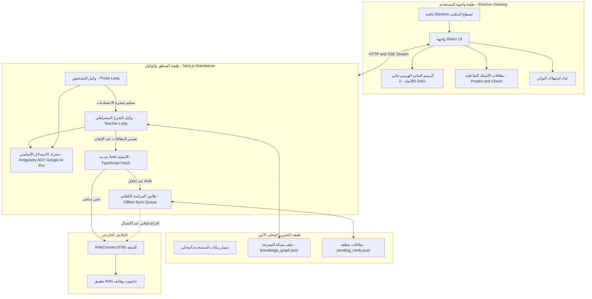

# وثيقة التصميم التقني: محرك التعلم السقراطي المدمج مع أنكي وواجهة Electron (LearnHarness)

* **المؤلف:** باسل / Antigravity
* **التاريخ:** 2026-10-27
* **الحالة:** وثيقة معتمدة ومصححة نهائياً

---

## 1. بيان المشكلة (The Problem)

يواجه المتعلمون للمواضيع الرياضية والتقنية العميقة (الجبر الخطي، معمارية النماذج اللغوية LLMs، التعلم العميق، الرؤية الحاسوبية) نمطين متناقضين من الفشل في الأدوات الحالية:
1. **فخ التلقي السلبي ووهم الطلاقة (Fluency Illusion):** قراءة الكتب أو مشاهدة الشروحات تعطي المتعلم شعوراً زائفاً بالفهم لمجرد وضوح الشرح، لكنه يعجز عن اشتقاق المفاهيم أو تطبيقها بشكل مستقل.
2. **إرهاق البطاقات والتفكك المفاهيمي (Flashcard Burnout):** أدوات التكرار المتباعد التقليدية (مثل Anki) تفتت المعرفة إلى حقائق معزولة. يعاني المتعلم من إجهاد كتابة البطاقات يدوياً، ويفقد شجرة الاعتماديات الهيكلية التي تربط أساسيات الجبر الخطي بنماذج الذكاء الاصطناعي، وينتهي به الأمر بحفظ نصوص الإجابات دون فهم اشتقاقي حقيقي.

**قيود وشروط المتعلم الصارمة:**
- **صفر كتابة يدوية:** عدم كتابة أي ملاحظات أو صياغة بطاقات أنكي يدوياً.
- **حد أدنى من القراءة:** تجنب النصوص الإنشائية الطويلة والمملة والتركيز على التفاعل الكثيف والسريع في ثوانٍ.
- **التعلم بالاشتقاق والمبادئ الأولى:** تثبيت المفاهيم وبناء الاعتماديات قبل الانتقال لما بعدها.

---

## 2. المنهجية الجوهرية: ركائز ومبادئ التعلم العميق العشرة (The 10 Core Doctrines)

يتبنى النظام منهجية LearnHarness المستقاة من أساليب الشرح الرياضي العميق (مثل 3Blue1Brown) والتي تتلخص في 10 قواعد تعليمية صارمة:

1. **الانطلاق من الحقائق غير المشروطة أولاً (Unconditional Truths First):** لا نبدأ من نظريات مشتقة، بل من بديهيات قطعية يقبلها العقل دون شروط أو استثناءات لتوفير أرضية صلبة تمنع تشكك الدماغ.
2. **دافع الاكتشاف الذاتي ("How Could I Have Discovered This?"):** لا تفرض أي معادلة أو معمارية كأمر واقع أو اعتباطي، بل اشرح المشكلة الأصلية التي اضطرت العلماء لاختراع هذا الحل خطوة بخطوة.
3. **خطوة استدلالية واحدة في كل مرة (One Reasoning Step at a Time):** كل خطوة تنقل المتعلم من حقيقة واضحة إلى النتيجة التالية مباشرة؛ إذا احتاجت الفكرة شرحين، تُقسّم إلى خطوتين.
4. **التشخيص الاستكشافي المسبق بالبحث الثنائي (Binary-Search Probing):** قياس حدود معرفة المتعلم وحصرها بدقة (تحديد سقف ما يجهله وأرضية ما يتقنه) قبل تقديم أي شرح جديد.
5. **حلقة (توقع -> شرح -> فحص) (Predict → Teach → Check):**
   - **التوقع (Predict):** إلزامه بتخمين السلوك القادم قبل كشف الإجابة لشد انتباهه.
   - **الشرح (Teach):** بيان الفكرة بأسلوب اشتقاقي مبسط ومسبب.
   - **الفحص (Check):** اختبار فوري بمسألة تطبيقية للتأكد من رسوخ المفهوم.
6. **التطبيق وليس الترديد (Application over Recitation):** الأسئلة تختبر القدرة على استخدام المفهوم في حالات جديدة، وتمنع تماماً أسئلة الحفظ التي تكرر كلمات النموذج.
7. **كشف وتسمية النماذج الخاطئة مبكراً (Name the Misconception):** صياغة خيارات الفحص بحيث يكشف الخطأ عن النموذج العقلي الخاطئ للمتعلم لعلاجه فوراً قبل البناء عليه.
8. **شجرة الاعتماديات الدنيا (Minimal Dependency Tree):** الخطة التعليمية لا تدرس ما يعرفه مسبقاً، ولا تنحرف عن الهدف النهائي؛ المسار هو أقصر خط اشتقاقي ممكن.
9. **مرونة الخريطة مع استجابة المتعلم (The Map Moves With Him):** الخطة ليست جدولاً ثابتاً، بل فرضية تتغير وتتسع وتتعدل فورياً كلما كشفت إجابات المتعلم عن ثغرة خفية.
10. **مبدأ الحد الأدنى من المعلومات في التثبيت (Minimum Information Principle):** تلخيص كل مفهوم تم إتقانه في بطاقتين أو ثلاث بطاقات Anki ذرية فائقة السرعة للمراجعة في ثوانٍ.
11. **التجريب وبناء الحدس واختبار الحالات الحدية (Ultralearning Experimentation & Edge-Cases):** بعد اكتمال الشرح، يتحدى الوكيل المتعلم بحالة حدية غير مألوفة (Counter-example / Boundary condition) أو تجربة رياضية شاذة لضمان رسوخ الحدس والقدرة على تطبيق المفهوم خارج الأمثلة النمطية.

---

## 3. قرار معمارية واجهة المستخدم: اعتماد واجهة ثنائية الأبعاد (2D DAG Only)

**القرار المعماري الصارم:** تم إلغاء أي تمثيل ثلاثي الأبعاد، وتثبيت **الرسم البياني الهرمي ثنائي الأبعاد (2D Hierarchical Directed Acyclic Graph - DAG)** حصراً:
1. **الخريطة الهرمية ثنائية الأبعاد (2D D3 Graph):** استعراض شجرة المفاهيم كشبكة هرمية واضحة ثنائية الأبعاد تنطلق من الأساسيات في الأسفل وتصعد نحو المفاهيم المركبة، وتُظهر مسار التعلم وحالة كل مفهوم بالألوان (أخضر للمتقن، برتقالي لقيد التعلم).
2. **عداد الاستهلاك الحي (Live Token & Cost Meter):** عرض استهلاك التوكن في زاوية الشاشة بشكل مرئي مباشر.
3. **أزرار الفحص السلسة (Interactive Quiz Cards):** بطاقات فحص الفهم التفاعلية المنبثقة القابلة للطي والمطابقة للمنهجية السقراطية.
4. **تطبيق سطح مكتب مستقل (Electron):** نافذة مخصصة للتعلم المركز تجمع المحادثة والرسم البياني ثنائي الأبعاد في مكان واحد.

---

## 4. الأهداف وغير الأهداف (Goals and Non-Goals)

### الأهداف الداخلة في النطاق (In-Scope Goals)
- الاعتماد المباشر على **Antigravity (AGY)** ونموذج **Google AI Pro** الخاص بالمستخدم كمحرك وحيد وأساسي للاستدلال.
- واجهة سطح مكتب بـ Electron مع رسم بياني هرمي **ثنائي الأبعاد (2D DAG)** حصراً.
- تطبيق المبادئ التعليمية العشرة كاملة في صياغة الحوار واشتقاق النماذج الرياضية من المبادئ الأولى.
- دمج خدمة Anki الأصلية بـ TypeScript لحقن بطاقات المراجعة الذرية فائقة السرعة عبر `AnkiConnect`، مع طابور حفظ محلي للمزامنة التلقائية عند إغلاق Anki.
- تخزين الجلسات وشبكة المعرفة محلياً في ملفات JSON قياسية بكتابة ذرية تحمي البيانات من التلف.

### خارج النطاق (Out-of-Scope Non-Goals)
- **التمثيل ثلاثي الأبعاد (3D Force Graph):** ملغي ومستبعد نهائياً لتفادي تشتيت المتعلم واستهلاك المعالج.
- **تعدد المزودين والنماذج المحلية:** مستبعد من V1 بالكامل؛ لا حاجة لـ Ollama أو وسائط معقدة في ظل وجود Google AI Pro عبر AGY.
- **التكامل مع أوبسيديان (Obsidian):** مستبعد بالكامل بناءً على تحليل YAGNI.
- **التأليف اليدوي للملاحظات والبطاقات:** لن يُطلب من المتعلم كتابة أي بطاقة أو تلخيص يدوي.

---

## 5. الخطة التقنية والمعمارية المبسطة (Technical Plan)

### أ. البنية المعمارية للنظام (System Architecture)



### ب. المكونات الأساسية وتدفق البيانات وعقود التشغيل (Component Contracts)

1. **غلاف Electron والاتصال بالخادم:**
   - تطبيق Electron يمثل نافذة سطح مكتب خفيفة مخصصة تفتح مسار خادم Next.js المحلي عبر منفذ يتم اكتشافه ديناميكياً لتفادي أي تضارب للمنافذ.
   - الاتصال بين واجهة React والخادم يتم عبر HTTP و Server-Sent Events (SSE) المتدفقة لنقل ردود AGY لحظة بلحظة.

2. **وكيل التشخيص والشرح السقراطي عبر AGY (Socratic Engine via Google AI Pro):**
   - **وكيل التشخيص (`ProbeAgent`):** يبدأ الجلسة بإجراء بحث ثنائي لحصر حدود معرفة المتعلم في كل مسار، ثم ينتج شجرة الخطة الهرمية ويسلم السياق لوكيل الشرح (`TeacherAgent`).
   - **محرك الاستدلال:** الاعتماد المباشر على **Antigravity (AGY)** عبر اشتراك Google AI Pro، مما يوفر استدلالاً رياضياً فائقاً للجبر الخطي والـ LLMs، وسياقاً ضخماً، وبلا قيود كوتا مزعجة أو تعقيد تعدد مزودين.

3. **خدمة Anki الأصلية وطابور المزامنة الذاتية (Native TypeScript Anki Service):**
   - كود TypeScript أصلي بالكامل داخل الخادم يتخاطب مع `http://127.0.0.1:8765` مباشرة عبر `fetch()`.
   - **طابور المزامنة الذاتي:** إذا كان تطبيق Anki مغلقاً، تُحفظ البطاقات في `pending_cards.json`، ويتم تفريغها وحقنها تلقائياً بمجرد عودة الاتصال بـ AnkiConnect دون أي إزعاج للمتعلم.

4. **مخطط بيانات شبكة المعرفة والتخزين الذري (Knowledge Graph Schema & Atomic Storage):**
   - **عقد البيانات المعتمد (Data Contract):**
     ```typescript
     export interface ConceptNode {
       id: string; // مثال: "linalg_eigenvalues"
       title: string;
       status: "mastered" | "learning" | "gap" | "planned";
       prerequisites: string[]; // المعرفات السابقة المطلوبة
       derivationSteps: string[];
       ankiCardIds: number[];
       lastTestedAt?: string;
     }

     export interface KnowledgeGraphState {
       activeTopic: string;
       nodes: Record<string, ConceptNode>;
       edges: Array<{ from: string; to: string }>;
       updatedAt: string;
     }
     ```
   - ترسم واجهة D3 هذه البيانات في شكل **رسم بياني هرمي ثنائي الأبعاد (2D Hierarchical DAG)** يوضح المسار الاشتقاقي الصاعد من الأساسيات إلى التطبيقات المتقدمة.

---

## 6. البدائل التي تم بحثها واستبعادها (Alternatives Considered)

1. **التمثيل ثلاثي الأبعاد (3D Force Graph):** تم استبعاده وحذفه كلياً لأنه ميزة استعراضية تشتت الذهن وتستهلك موارد كرت الشاشة، واستبدل برسم هرمي ثنائي الأبعاد واضح.
2. **تعدد المزودين والنماذج المحلية الصغيرة (Local Models / Multi-provider):** تم استبعاده لعدم كفاءة نماذج 8B في الاستدلال الرياضي ولتجنب تعقيد الكود، مع الاعتماد الكلي على AGY و Google AI Pro.
3. **دمج أوبسيديان (Obsidian):** تم استبعاده وفق مبدأ YAGNI لأن المتعلم لا يريد كتابة ملاحظات يدوية وواجهة Electron توفر الرسم البياني المطلوب.
4. **وسيط بايثون لجسر Anki:** تم استبعاده لحذف ازدواجية بيئات التشغيل، والاعتماد على كود TypeScript أصلي خفيف.

---

## 7. خطة التنفيذ التفصيلية (Detailed Implementation Plan)

### أ. قائمة المهام الموحدة وتواقيع الواجهات البرمجية (Unified Tasks & API Contracts)

1. **إعداد البنية التحتية لتطبيق Electron والخادم:**
   - نسخ هيكل مشروع LearnHarness الأساسي من المستودع المحلي `/tmp/learnharness_repo` إلى المجلد المستقل `/home/basel/Work/LearnHarness/desktop`.
   - تثبيت اعتماديات Node.js (`npm install`) والتحقق من سلامة بناء خادم Next.js المستقل.
   - ربط استدعاءات الاستدلال عبر AGY SDK ونموذج Google AI Pro مباشرة.

2. **تجهيز وإدماج خدمة Anki الأصلية بـ TypeScript (`src/services/anki.ts`):**
   - كتابة خدمة اتصال HTTP أصلية بـ `AnkiConnect` (المنفذ `8765`) بدون أي وسيط خارجي.
   - بناء طابور المزامنة الذاتي (`pending_cards.json`) لمعالجة حالات انقطاع الاتصال.
   - **توقيع الخدمة وهيكل البيانات (Data Contracts):**
     ```typescript
     export interface AnkiCardPayload {
       id: string; // معرف المفهوم
       deckName: string; // "LearnHarness::AI"
       modelName: "Cloze" | "Basic";
       fields: {
         Front?: string;
         Back?: string;
         Text?: string; // لحقول نصوص Cloze
         Extra?: string;
       };
       tags: string[];
     }

     export class AnkiService {
       async ping(): Promise<boolean>;
       async ensureDeckAndModel(deckName: string): Promise<void>;
       async addCard(card: AnkiCardPayload): Promise<{ success: boolean; noteId?: number; queued?: boolean }>;
       async syncPendingQueue(): Promise<{ synced: number; remaining: number }>;
     }
     ```

3. **تطبيق مبادئ التعلم السقراطية العشرة في موجهات النظام:**
   - تحديث موجهات النظام لتطبيق الانطلاق من الحقائق غير المشروطة أولاً والاستكشاف المسبب (أسلوب 3Blue1Brown).
   - توجيه الأسئلة بنمط: حصر واستكشاف (Probe) -> توقع (Predict) -> شرح اشتقاقي (Teach) -> فحص تطبيقي (Check).

4. **تحديث ومزامنة الخريطة الحية ثنائية الأبعاد (2D DAG):**
   - تطبيق الكتابة الذرية (Atomic Writes) في تحديث `knowledge_graph.json` لحماية البيانات.
   - بث تحديثات العقد فورياً للواجهة عبر قناة Electron IPC (`graph:updated`) ليتم تحديث لوحة D3 الهرمية ثنائية الأبعاد (2D Hierarchical DAG) دون الحاجة لإعادة تحميل الصفحة.

---

### ب. قائمة الملفات التي سيتم إنشاؤها وتعديلها (File Impact & Rationale)

| مسار الملف | نوع العملية | الغرض والتعليل البرمجي |
|---|---|---|
| `/home/basel/Work/LearnHarness/desktop/` | نسخ وتثبيت | نسخ ملفات المشروع من `/tmp/learnharness_repo` إلى مجلد العمل المستقل. |
| `/home/basel/Work/LearnHarness/desktop/src/services/anki.ts` | إنشاء | خدمة TypeScript أصلية للتواصل مع AnkiConnect وإدارة طابور المزامنة التلقائي بدون بايثون. |
| `/home/basel/Work/LearnHarness/desktop/src/services/agy-client.ts` | إنشاء | عميل الاتصال المباشر بنموذج Google AI Pro عبر AGY. |
| `/home/basel/Work/LearnHarness/desktop/src/store/atomic-storage.ts` | إنشاء | دوال كتابة ذرية لملفات JSON لحماية شجرة المعرفة من التلف المفاجئ. |
| `/home/basel/Work/LearnHarness/desktop/src/components/KnowledgeGraphView.tsx` | إنشاء/تعديل | مكون React يعتمد مكتبة D3.js لرسم وتحديث شجرة المفاهيم الهرمية 2D DAG فورياً. |
| `/home/basel/Work/LearnHarness/desktop/electron/preload.cjs` | تعديل | تأمين قنوات الـ IPC (`graph:updated`) بين نافذة Next.js وعملية Electron الأساسية. |
| `/home/basel/Work/LearnHarness/desktop/electron/main.cjs` | تعديل | ضبط مسار تشغيل خادم Next.js واكتشاف المنافذ الحرة ديناميكياً وتأمين نوافذ Electron. |
| `/home/basel/Work/LearnHarness/desktop/src/agent/prompts/teacher/05-method.md` | تعديل | تعزيز المبادئ العشرة لتدريس الجبر الخطي والـ LLMs بالاشتقاق الرياضي. |
| `/home/basel/Work/LearnHarness/desktop/tests/services/anki.test.ts` | إنشاء | اختبارات وحدة لخدمة Anki وطابور المزامنة التلقائي. |

---

### ج. خطة التحقق والاختبار (Verification & Test Plan)

1. **فحص اتصال AnkiConnect عبر الطرفية:**
   ```bash
   curl -s -X POST http://127.0.0.1:8765 -d '{"action": "version", "version": 6}' | grep "result"
   ```
2. **اختبارات الوحدة (Unit Tests via Vitest):**
   ```bash
   cd /home/basel/Work/LearnHarness/desktop && npm run test:unit
   ```
3. **فحص بناء وتجميع المشروع (Production Build Check):**
   ```bash
   cd /home/basel/Work/LearnHarness/desktop && npm run build
   ```
4. **تشغيل بيئة سطح المكتب للتطوير (Desktop Dev Launch):**
   ```bash
   cd /home/basel/Work/LearnHarness/desktop && npm run desktop:dev
   ```

---

### د. معايير القبول والتسليم (Definition of Done)

- [ ] اكتمال نسخ وتثبيت بيئة `desktop` ونجاح أمر `npm run build` بدون أخطاء.
- [ ] اعتماد الرسم البياني ثنائي الأبعاد (2D DAG) حصراً وخلو الواجهة تماماً من أي أكواد ثلاثية الأبعاد.
- [ ] ربط محرك الاستدلال بنموذج Google AI Pro الخاص بالمستخدم عبر AGY حصراً، دون أي نماذج محلية أو مزودين إضافيين.
- [ ] نجاح حقن بطاقة اختبارية في Anki وظهورها في رزمة `LearnHarness::AI` مدعومة بـ MathJax.
- [ ] تجربة محاكاة انقطاع Anki والتأكد من حفظ البطاقة في `pending_cards.json` وإفراغها آلياً عند إعادة التشغيل.
- [ ] تحديث رسم D3 الهرمي ثنائي الأبعاد فورياً عند انتقال المفهوم لحالة `mastered`.
